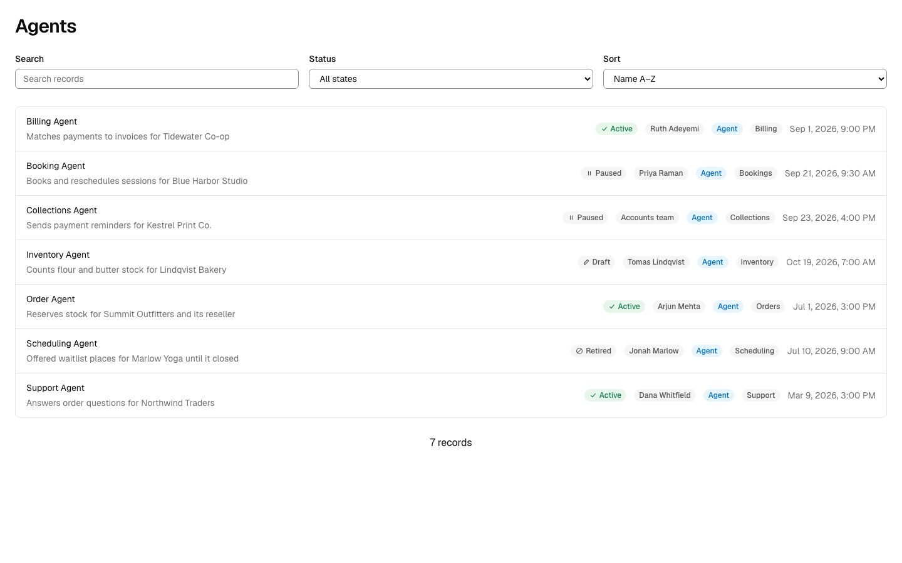
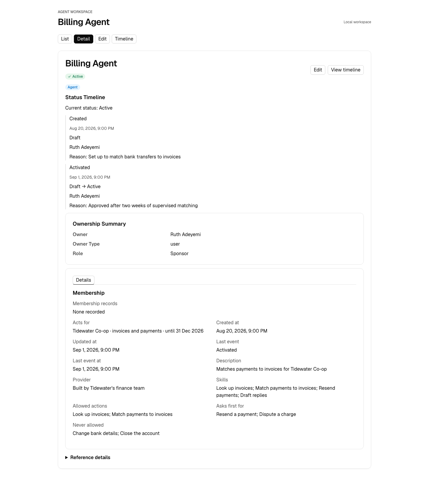
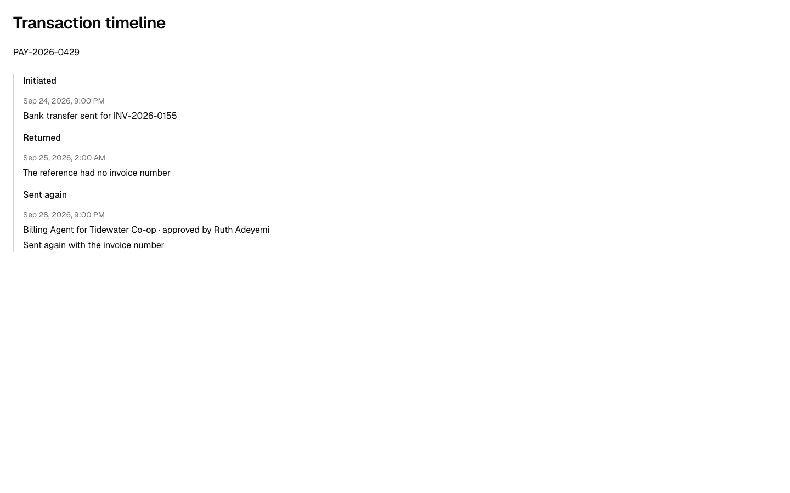

# Agents as actors

An AI agent that acts inside a product is an **actor, not a user**. In OODS Foundry it is an object of its own, `Agent`, that shares one trait with `User`: the ability to act. It answers to a sponsor, holds roles, has a lifecycle, and acts for people and organizations only under a grant. Every change it makes is recorded with both names: who acted, and who it acted for.

## Why not a kind of user

Many products store their agents as users, often with a flag. They do it because their roles, licences and audit logs can only point at users. In OODS a `User` is a person's account, with home and billing addresses, notification preferences and a required email, and none of that describes an agent. The newer identity systems give agents a principal type of their own: Google's agent identities, Okta's AI agents, the SCIM `Agent` resource draft and AWS AgentCore's workload identities.

OODS composes objects from traits, so the fix is in the traits: everything that names an actor accepts any object that can act.

## The object and its traits

`Agent` composes five traits:

| Trait | What it gives an agent |
|---|---|
| `Actor` (kind `agent`) | The ability to act: to be named in history, hold a role, own a record. An agent is marked **Agent** beside its name in lists, cards and its own page. |
| `Ownerable` | A required **sponsor**: a person or a team the agent answers to. |
| `Authable` | Roles, through the same memberships people have. A membership names a user (`user_id`) or any other actor (`actor_id` with `actor_kind`). |
| `Stateful` | A lifecycle: draft, active, paused, retired. |
| `Timestampable` | When it was created and last changed. |

`User` composes `Actor` too, as a person. Its fields and screens are unchanged.

Agent's own fields are one line of text each, so they show on its page and edit in its form:

- `provider`: who built or runs it;
- `skills`: what it can do, such as "Look up invoices; Match payments to invoices; Resend payments";
- `acts_for`: who it acts for, one phrase per grant, such as "Tidewater Co-op · invoices and payments · until 31 Dec 2026";
- `allowed_actions`, `asks_first_for` and `never_allowed`: its approval rules.

A list is written as one line with its items separated by "; ", and "None" when it is empty.

## Two names on every change

The line an agent leaves in another record's history is its most-seen screen. Every recorded change can name three parties, through optional fields on a history entry (`Stateful`'s `state_history`, `Auditable`'s `audit_log`):

| Field | Holds |
|---|---|
| `actor_name`, `actor_id` | who acted |
| `actor_kind` | person, agent or system |
| `on_behalf_of_name`, `on_behalf_of_id` | who it acted for |
| `approved_by_name`, `approved_by_id` | who approved it, when someone did |

Every history in OODS Foundry prints them as one line:

- **Billing Agent for Tidewater Co-op · approved by Ruth Adeyemi**: an agent acting for an organization, with a person's approval;
- **Ruth Adeyemi**: a person acting for herself;
- **Billing Agent**: an agent acting as itself.

A history written before these fields, with no names, shows exactly as it always has.

## On whose behalf: delegation

"On behalf of" is a relationship, not a property of the agent. A `Relationship` of type `delegation` runs from the person or organization acted for (its source) to the agent (its target):

- its scope and end date are in its label and description: "Acts for Tidewater Co-op on invoices and payments until 31 Dec 2026";
- its lifecycle is the grant's: proposed (requested), active, paused, then terminated (revoked) or completed (expired);
- the agent's `acts_for` names the same grant on its own page.

## Approval and work

Approval is a rule per action, not a trait of the agent: an action is allowed, asked first, or never taken. That is what `allowed_actions`, `asks_first_for` and `never_allowed` record. When a person approves an action the agent asked about, the change names them (`approved_by_name`).

An agent's work keeps the states its protocol gives it. A2A's task states (submitted, working, input-required, auth-required, completed, failed, canceled, rejected) arrive through the importer as a `Stateful` lifecycle on the record that holds them.

## Bringing your own agent records

`object_import` recognizes agent records where the schema carries the evidence, and grades each proposal by it: owners or sponsors that point at people or groups, a run-as or on-behalf-of reference, a bot or app flag beside an app reference, an enabled flag. A name alone is weak evidence, and nothing is applied without your acceptance. See [IMPORTING-OBJECTS.md](../../packages/foundry/IMPORTING-OBJECTS.md).

## When a product needs the agent to be a user

Some features only accept users: a seat licence, a mention picker, a sign-in. Microsoft's Entra Agent ID handles this with an optional agent user, a user account linked one-to-one to the agent identity and made only where the agent has to act as a user. In OODS, model the same thing as two records: the `Agent`, and a `User` for the account that feature needs, linked by a `Relationship`. Keep the agent's approval rules, sponsor and history on the `Agent`.

## What OODS Foundry does not do

It models and renders. It does not run agents, issue tokens, check permissions or enforce approval rules; those belong to your runtime, your identity provider and your directory.
