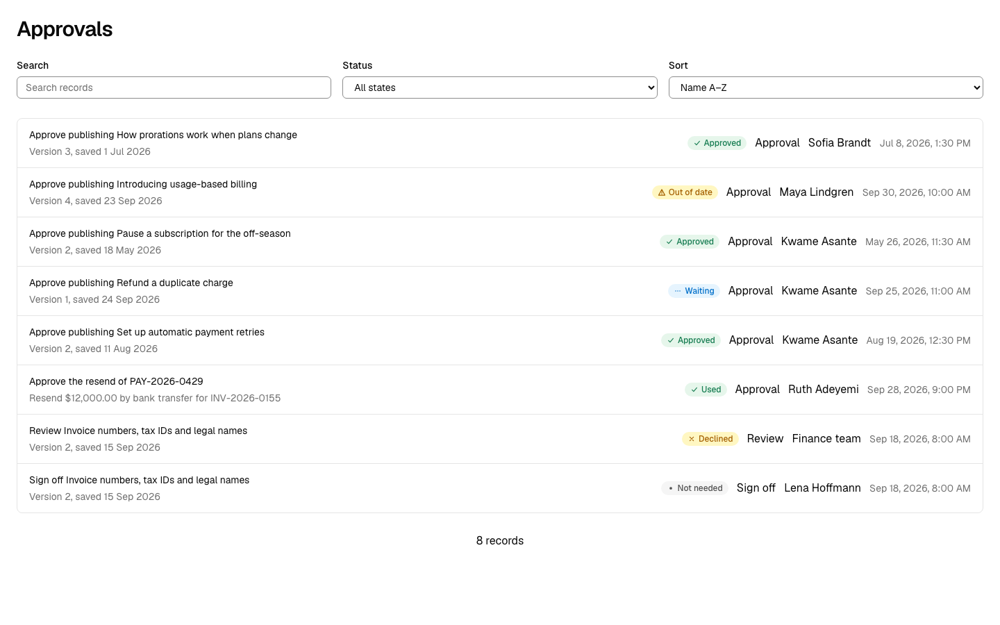
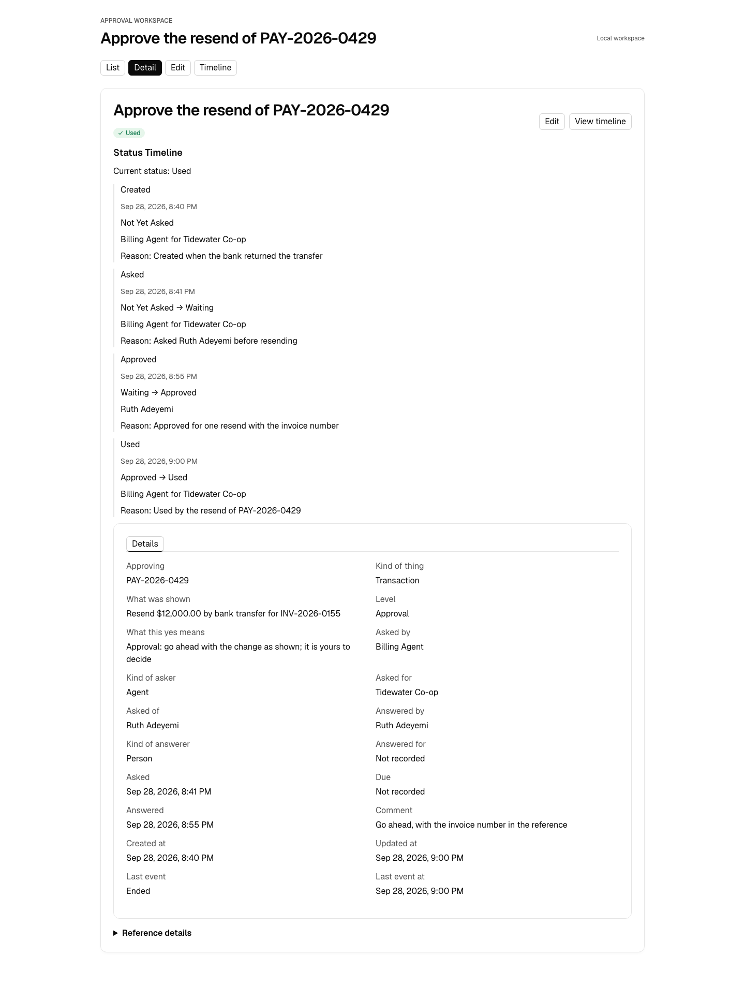
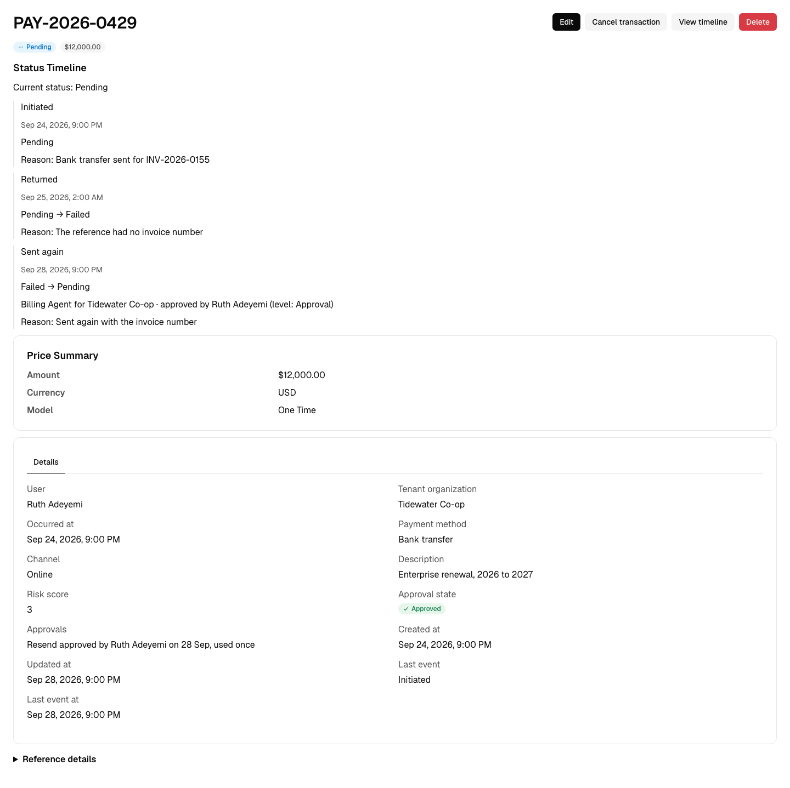
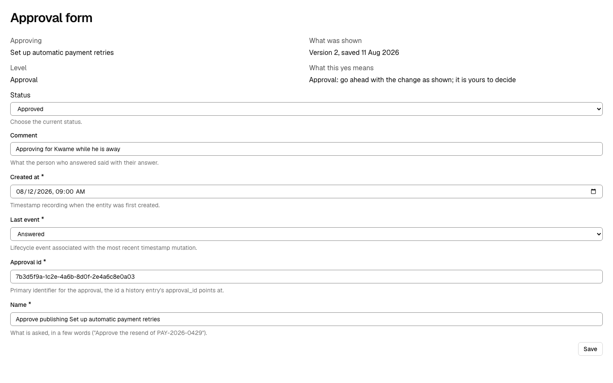

# Approvals as decisions

When someone approves something in your product, what gets saved? In OODS Foundry an approval is **a decision, not a status**: one person's (or agent's) answer about one version of one thing, at a level of yes the product names. It is an object of its own, `Approval`. The thing approved carries a trait, `Approvable`, that holds its rule and its outcome. A standing yes, such as "always allow", is a change to a grant. The line in the thing's history is the trace.

## Object, trait, relationship or entry?

Whether a new thing is an object, a trait, a relationship or an entry is decided by one test, applied by reviewers who are not told which answer is wanted:

- **An object** is something people count with a noun and open by itself. It has its own identity and its own life: it can be waiting, late or withdrawn while the thing it points at is unchanged. Someone needs a list of them. It can outlive, or disagree with, what it points at.
- **A trait** is a rule or a fact that many kinds of thing share: one value per thing, meaningless off it. You cannot count them or open one.
- **A relationship** is a standing link between exactly two things, fully said as "A, type, B, until when", needing no new field.
- **An entry** is something that already happened to a record: never edited, read in that record's history, never opened alone.
- **Both an object and a trait**, when it passes both tests: the noun is the object, and the ability to have one is the trait.

An approval passes both. People say "three approvals waiting", and an ask can wait, be answered, withdrawn or expire while the thing stays as it was: that is the object. The thing still needs its half, the rule and the outcome: that is the trait. The Agent was the same shape: `Agent` the object, `Actor` the trait.

## The object and its two traits

`Approval` composes three traits:

| Trait | What it gives an approval |
|---|---|
| `Decision` | The record's facts: who asked and for whom, who was asked, who answered and for whom, the thing, exactly what was shown, the level, what this yes means, when it was asked, due and answered, and the comment. |
| `Stateful` | The answer, as a lifecycle: not yet asked, waiting, approved, declined, then how it ends: out of date, taken back, expired, withdrawn, not needed, used. |
| `Timestampable` | When it was created and last changed. |

**One row per approver.** An ask to three people is three approvals, so each can be answered, chased or withdrawn on its own, and two can be answered at once. An approval never stands alone: it names its thing by the id your product calls it by, and keeps the thing's name, so it still reads after the thing changes or is deleted.

**Not yet asked** is the first state: the approval exists before it is this person's turn, as when people are asked in order.

The thing approved composes `Approvable`. Its parameters are the rule: the levels it declares, what each level is, which change needs which level (a state it moves to, such as published, or a named action, such as resend), how many yeses a level needs, whether the asker may answer, which levels an agent's yes may satisfy, and whether a yes lapses when the thing changes. Its two fields are the outcome: `approval_state` (not required, waiting, approved, declined, out of date) and `approval_summary`, one line it rests on. Both are read-only: your product works the outcome out from the approvals that still stand and writes it; OODS Foundry shows it on the thing's page and keeps it off the thing's form.

In the reference objects, `Transaction` and `Article` compose `Approvable`: a resend of a payment needs an approval, and so does publishing a guide or an announcement.

## Levels, and the meaning kept on each record

A level is a name your product declares, the way it declares a lifecycle's states. Sources do not agree on one ladder, so OODS gives no universal one. Each name is a noun for the kind of yes asked for, so it reads beside any answer: "Sign off, declined". The examples in OODS Foundry come from working systems:

- **Acknowledgement**: "I have seen this." It permits nothing.
- **Review**: "I read it and it looks right." It counts, but decides nothing.
- **Approval**: "Go ahead; this is mine to decide." It permits the change, and lapses if the thing changes.
- **Sign-off**: "I answer for this." The most deliberate, with its meaning written down.

`Approvable`'s level definitions say, for each level, who may give it, what it permits, what must be in front of the person, what a wrong one costs, how deliberate the act is and when it lapses.

Each approval keeps its level, and one line saying what this yes means and permits, in words, written by your product when it asks: "Sign-off: you answer for its tax and legal content". A signed record must show "the meaning (such as review, approval, responsibility, or authorship) associated with the signature" (21 CFR 11.50), so the meaning belongs on the record itself.

## The history line

A change someone approved can say which approval it belongs to and what level of yes it was, through two optional fields on a history entry (`Stateful`'s `state_history`, `Auditable`'s `audit_log`):

| Field | Holds |
|---|---|
| `approval_id` | the Approval the yes is kept in |
| `approval_level` | the level of yes |

Every history in OODS Foundry prints the level in its line: **Billing Agent for Tidewater Co-op · approved by Ruth Adeyemi (level: Approval)**. The approval's id stays in the record's data. It is a pointer, not a link: a generated app holds one object's records, so the line cannot open the approval. An entry without the two fields prints exactly as before.

## Where it meets the Agent

- **A one-time yes is an Approval.** When the Billing Agent asks Ruth Adeyemi before resending a payment, the approval records who asked and for whom, who answered, exactly what was shown ("Resend $12,000.00 by bank transfer for INV-2026-0155"), the level, and that the yes was used by the resend. If the agent changed the amount, the yes would be out of date.
- **A standing yes is a grant.** "Always allow" is a change to the agent's rules or its delegation, recorded on the agent, not an approval of one action. See [Agents as actors](agents-as-actors.md).
- **A yes that waits for no one and needs no evidence is a history line.** A card issuer's authorization is one: it stays a line in the payment's history.

## The screen where an answer is given

On an approval's form, the screen where the answer is chosen, the thing, exactly what was shown, the level and the meaning are read as facts beside the answer. They cannot be edited there, on the composed screen or in a generated app.

`design_compose` holds every such screen to those four facts. A screen is one where an answer can be given when it has a control that edits the approval's lifecycle; a list's filter, sort and search are not answer controls, so a list never is.

- If the record keeps a fact and the screen leaves it out, the composer **refuses** the screen (`OODS-V221`), naming the fact.
- If the record does not keep a fact at all, as when an imported table has no field for it, the screen **composes** and `design_compose`'s reply **warns** (`OODS-V222`), naming the fact.

What the rule checks: that each fact the record keeps is on the screen. What it cannot check: whether the words are true, current or enough (it never reads a record's values); whether the reader can see them, above the fold or behind a tab; whether the meaning is the right one for the level; who is looking, or whether they may answer; anything a team changes in generated code afterwards, or any app generated before 0.13.0. It asks for the same four facts at every level.

## Bringing your own approval records

`object_import` recognizes another system's table of approvals where the schema carries the evidence, and proposes `Decision` for it, graded on structure. A record that holds a single reference to a person or other principal beside an answer (a decision or state with an approve value and a reject, decline or request-changes value) earns a medium proposal, with the person as the one asked and the record's lifecycle on the answer. Either alone proposes nothing. The importer binds the asker, the thing, the dates, the comment and the version shown where the record names them, and leaves every other fact out; nothing is applied without your acceptance. Accepting a proposal never fails for a fact the source lacks: the warning naming it appears when the answer screen is composed with `design_compose`, not at acceptance. Jira Service Management's approvers, Gitea's pull request reviews and Bitbucket Cloud's participants are recognized this way. The importer does not propose `Approvable`. See [IMPORTING-OBJECTS.md](../../packages/foundry/IMPORTING-OBJECTS.md).

## What OODS Foundry does not do

It models and renders. It does not ask anyone, check who may approve, count approvals, expire an ask, sign anything, lock a record or stop a change; those belong to your product and your runtime. It cannot yet list a thing's approvals on the thing's own page, or show a signed-in person "waiting for your yes": the thing's outcome and summary are kept by your product, not worked out by OODS Foundry.
