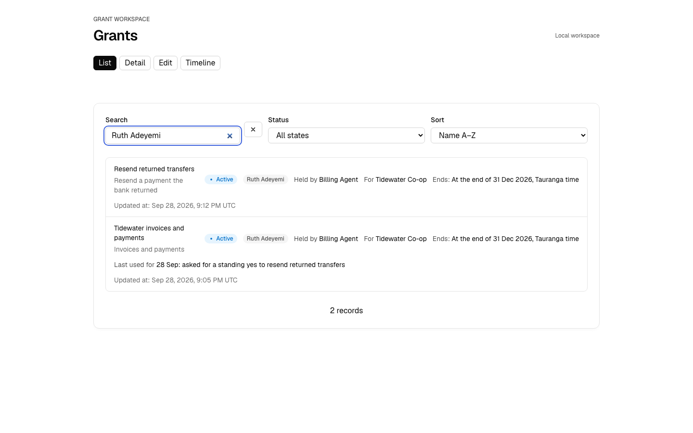
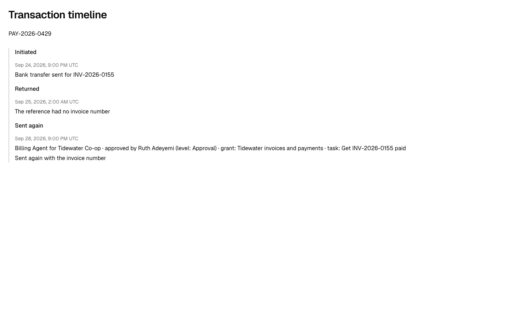

# Grants as standing yeses

> **The Grant story has three parts.** [Grants as standing yeses](grants-as-standing-yeses.md): what a grant is.
> [The person's side](the-persons-side.md): where a person sees their grants, and takes one back.
> [What became of the work](what-became-of-the-work.md): what a product reports after a grant ended.
> Taking a grant back ends the yes, not the work.

When someone tells an agent it can keep doing something, what gets saved, and where do they see it and take it back? In OODS Foundry a grant is **a standing yes, not a setting**: one set of terms on which one actor may act for one person or organization, as given by one person, until it ends. It is an object of its own, `Grant`. Its facts live on a trait, `Mandate`, so your own consent, mandate or connection records can take them too. Every change an agent makes under a grant can name it in that record's history.

## What a grant is, and what it is not

| Thing | What it is | How a grant differs |
|---|---|---|
| A role | A position in an organization, for anyone who holds it | A role has no giver acting for a party, and no end |
| A permission setting | One value on one thing | A setting has no giver, no party, no end and no trace |
| A token | What a system issues under a grant | A token may be narrower than its grant, and may outlive it |
| A saved "always allow" | A rule in a settings file, in most products | Here it is a grant of its own, inside the first, with a giver, bounds and an end |
| An approval | One yes about one version of one thing, used once (see [Approvals as decisions](approvals-as-decisions.md)) | A grant stands for many uses within its terms |
| A delegation | A `Relationship` of type `delegation`, the link alone | A grant has three parties and terms; teams that keep the link keep the type |

## The object and its traits

`Grant` composes four traits:

| Trait | What it gives a grant |
|---|---|
| `Mandate` | The record's facts: who asked for it, who gave it and in what capacity, who holds it, who it is for, what it covers, its three lines for that party, its limits, its end, its use, the grant it sits inside or replaced, and who ended it and why. |
| `Stateful` | The grant's state, as a lifecycle with a declared order (below). |
| `Timestampable` | When it was asked for and last changed, and its latest event (given, paused, resumed, ended or updated) and when. |
| `Ownerable` | The one who answers for it: a person or a team, never an agent. |

**Its terms are never edited in place.** A change of terms is a new grant that names the one it replaces; the old one ends as replaced and is kept whole. A renewal is a replacement with a later end.

## The seats

| Seat | Who can sit in it |
|---|---|
| **Asked for by** | A person, or the agent itself. |
| **Given by** | A person, with the capacity they gave it in ("Finance manager, Tidewater Co-op"). |
| **For** | A person or an organization. Never an agent. |
| **Held by** | An agent, or a person standing in for someone. |
| **Answers for it** | A person or a team. By default, the one who gave it. |
| **Ended by** | Who ended it, and why. |

The seats are fields at the top of the record, so a search for a name on the Grant list finds every grant that names it: everything Ruth Adeyemi gave, everything held for Tidewater Co-op, everything the Billing Agent holds.

**Who may end a grant** is a rule, not a field: anyone who may give grants for the party, the one who gave it, the one who answers for it, and the holder giving it up. Nothing checks it, because OODS Foundry does not know who is looking.

## The terms, and the three layers

A grant's terms are:
- what it covers, in a few words;
- three lines for this party, in the agent's own convention: what goes ahead with no one asked, what needs a yes first, and what never happens. Anything no line names never happens;
- money limits per use and per period, in the currency’s minor units, and a maximum number of uses per period;
- conditions in words, which are shown and not checked;
- an end (below).

Three layers apply to an agent acting for a party, each with its own owner, and the stricter always wins:
- **The agent's own lines** are its sponsor's ceiling. "Never" is never lifted. "Asks first" means the action needs a yes: asked each time, or given in advance by a standing yes under a grant (below).
- **The grant** is the party's: it can narrow the agent's lines for that party, never widen them.
- **The thing's own rule** (`Approvable`, see [Approvals as decisions](approvals-as-decisions.md)) is your product's: which change of a payment or an article needs which level of yes.

**A budget on a grant is the money it may move.** The cost of the agent's work is not on the grant.

## A yes given in advance

Where a thing's rule requires a yes for a change, a standing yes counts only if that rule opens the change to a yes given in advance: `Approvable`'s `inAdvance`, empty by default. `Transaction` opens resends. A standing yes satisfies the payment's required yes only when all five of these hold:
1. the thing's rule names the change in `inAdvance`;
2. the one who gave the standing yes is someone the level's "who" admits;
3. the standing yes lets the action go ahead, with bounds;
4. the use falls inside the bounds, while the grant is active;
5. the use names the grant.

Where a rule declares two or more levels, its last, most deliberate one is always asked: a payment's sign-off is never given in advance. The payment's outcome then reads **allowed in advance**, never "approved", because no one approved this one, and never "not required", because a yes was required. Your product checks all of this; OODS Foundry keeps the setting and shows the outcome.

A cost of this reading: a sponsor cannot say "ask every time, never in advance" for an action no thing's rule covers.

## Eight states

| State | In plain words |
|---|---|
| Requested | Asked for, and not given yet. |
| Active | Given, and it stands. It may stand unused. |
| Paused | It stands, and may not be used until it is resumed. Its end still runs. |
| Revoked | Someone ended it. Who ended it is kept when your product says who is acting, and why when they give a reason. |
| Expired | It reached its end, went unused as long as its terms allow, or was asked for and never answered in time. |
| Replaced | A newer grant with other terms took its place, and names it. |
| Declined | It was asked for, and the answer was no. |
| Withdrawn | The ask was called off before an answer, by its asker or by your product. |

The last five are endings, and final: a grant never comes back. A new grant follows it and names it. Paused is the one state a grant comes back from. No ending takes a success colour, and revoked is not a failure: it is the rule working. `Grant` declares this order. Your product enforces it on its own records, and OODS Foundry holds its own samples to it. A generated app keeps it in its own store: a grant's status select offers its state and the moves the order allows from it, and the store refuses any other move, so a revoked grant never goes back to active there.

**The end, in the party's own day.** A grant to an agent names its end, kept three ways: the exact instant a product checks (`ends_at`), the party's time zone (`timezone`, such as Pacific/Auckland), and one line in the party's own words and zone (`ends_note`, "At the end of 31 Dec 2026, Tauranga time"), written by your product. People read the line: the list, the card and the detail page show it, and the detail page also shows the instant. Every time a grant's screens show, the instant and its history included, is in UTC and says so ("Dec 31, 2026, 10:59 AM UTC"), and a form's date-time input says UTC in its label. For a grant with no end, your product writes that too ("No end: it stands until someone ends it"). Without that line, the list and card omit the end description. The detail page still shows the exact end time if the record supplies one. Showing a record's own times in its own zone on every screen is not built yet.

**Disuse** is your product's rule: the grant shows its last use, and a grant that ends unused is expired, with its reason ("Unused for 90 days"). Reconfirmation is not modelled yet.

Reconfirmation means asking the person who gave a grant whether it should still stand on the same terms. The history shows when the grant was given. If your product records the last-use time, the page shows that too. To ask again on a chosen date, your product needs a clock. A static page has none.

## "Always allow" is a grant inside a grant

A standing yes for one action is a new grant inside the grant it narrows. It has the same holder and the same party, covers one action, carries its own bounds and end, ends no later than the grant it sits in, and can be ended alone. It is given by someone who may give the first grant, never by its holder; the holder may ask for it. It never names an action the first grant or the holder never allows. Where its action moves money, it carries an amount per use, an amount per period, a count and an end.

## Taking it back

Taking a grant back is one change of its state, to revoked. In a generated app a grant is given by moving its status from requested to active on its form. Its page offers **Revoke** while it stands (active or paused), **Pause** while it is active and **Resume** while it is paused; an ended grant offers none of them, and a grant has no Delete: an ended grant is kept. Moving its status to revoked on its form is the same Revoke. [The person's side](the-persons-side.md) shows the three.

In a generated app, Revoke asks once first, on one screen: the grants inside it that end with it, the records that name it and are still under way, that revoking recalls nothing already issued, the other grants its holder still holds for the party, and who is ending it, with an optional note for the record. Pause asks nothing, and its result says how to resume. Resume gives the grant again, so a paused grant's page says that only someone who may give grants for the party should resume it; the app does not check.

What the record keeps: the grant stays, marked revoked, with when; who ended it, when your product tells the app who is acting; and why, when they give a reason. Each active or paused grant inside it ends at the same time and gets its own line ("Ended with Tidewater invoices and payments"). A grant still awaiting an answer stays open for an answer on its own page. What your product does: it withdraws the approvals asked or not yet used under it, and pauses or hands on a task under way. What does not change: work already done stays done, credentials issued under it may still work, and payments already sent are not recalled; revoking stops none of them. The grant's page lists the records here that name it and were still under way at its end, with their state then and now; work under it elsewhere is not shown. Taking back only the standing yes inside ends that one grant and leaves the first standing.

A generated app names who ended a grant when your product passes who is acting (`createWorkflow({ actor })`). Told no one, the grant's page says the app was not told who ended it.

## The trace on each line

A change made under a grant can say which grant it was, through two optional fields on a history entry (`Stateful`'s `state_history`, `Auditable`'s `audit_log`):

| Field | Holds |
|---|---|
| `grant_id` | the Grant the change was made under |
| `grant_name` | the grant, as shown |

Every history prints the grant after any approval and before the task: **Billing Agent for Tidewater Co-op · approved by Ruth Adeyemi (level: Approval) · grant: Tidewater invoices and payments · task: Get INV-2026-0155 paid**. A change a standing yes allowed was approved by no one, so its line names the grant and no approver: "Billing Agent for Tidewater Co-op · grant: Resend returned transfers". The grant's id stays in the record's data. It is a pointer, not a link: a generated app holds one object's records, so the line cannot open the grant. In OODS Foundry's samples, every line an agent writes for a party names the grant it acted under.

The task still keeps no field for the grant, because a task gives no authority: in OODS Foundry's samples, each line its doer writes for the party names the grant (see [Tasks as asks](tasks-as-asks.md)).

## The example

Times are UTC, as the records keep them; Tidewater Co-op is in Tauranga, New Zealand.
- **20 Aug, 21:30.** Ruth Adeyemi asks for a grant for the Billing Agent. It is requested.
- **1 Sep, 21:00.** Ruth gives it, as Finance manager of Tidewater Co-op: for Tidewater Co-op, held by the Billing Agent, covering invoices and payments. It looks up invoices and matches payments to invoices with no one asked; it asks first to resend a payment or dispute a charge; it never changes bank details or closes the account. It ends at the end of 31 Dec 2026, Tauranga time. Ruth answers for it.
- **28 Sep, 20:30 to 21:00.** The agent asks first, Ruth approves one resend, and it goes at 21:00 under that one-time approval. Every line the agent writes that evening names the grant.
- **28 Sep, 21:05.** The agent asks whether it may resend returned transfers without asking each time. At 21:12 Ruth gives a standing yes inside the Tidewater grant, "Resend returned transfers": a payment the bank returned, to the same payee for the same amount, with the invoice number in the reference, up to $12,000.00 each, at most $30,000.00 and three a month, until the Tidewater grant ends. It has not been used yet.

A later resend under it needs no new approval: its line names the standing yes, and the payment's outcome reads allowed in advance. It counts for the payment's rule only because `Transaction` opens resends to a yes given in advance.

## Helpers, and passing a grant on

In this release a helper acts under its own grant from the one the work is for, given by a person. The first agent may ask for it, and the grant records that it asked. Passing part of a grant on, as a grant inside a grant held by the helper, never wider and never longer, ending when the first grant ends and only where the first grant allows it, is not modelled yet.

## The person's side

A person's page lists what waits for their answer, the agents holding a grant for them, and the grants they gave or answer for. An organization's page lists the agents holding a grant for it and what was recorded on its behalf, and an agent's page the grants it holds. A grant's page lists the grants inside it, what was recorded under it, what is still under way, its parties now, and, once it has ended, its closure. [The person's side](the-persons-side.md) has each list and what it cannot see, and the story's third part, [What became of the work](what-became-of-the-work.md), what a product reports after a grant ended. There is no viewer: every page is composed the same for everyone, and none speaks to the person it lists as "you". The Grant list still finds a grant by the name in any of its seats, and filters by state.

## Bringing your own grant records

Your own consent, mandate or connection records can compose `Mandate` on an object of your own, beside your own lifecycle: the seats, the terms, the end and the use are the fields above, and a place your record holds no value for is left undrawn.

`object_import` proposes `Mandate` where another system's record has a grant's shape, from three facts together: a state with a value in force (active, granted, authorised, valid) beside one that says it was revoked or ended (revoked, expired, ended, terminated, withdrawn, deactivated), a date-time named for an end (`expires_at`, `expirationTime`, `valid_until`), and a single reference to the record of the agent or app that holds it. It binds who holds it, the end and, where the record references them, who gave it, asked for it and ended it and who it is for, and the state becomes the lifecycle; any other `Mandate` field binds only to a field of its own name and type. It never fills a scope or limits written inside the record (FDX's resources, Stripe's usage limits). An import of FDX 6.6's Consent Grant, Stripe's shared payment issued token, ReBIT's consent or GitHub's programmatic access grant gets no `Mandate`, because each lacks one of the three facts, while a team's own flat table, with text ids, gets every seat it holds a column for. The [importing guide](../../packages/foundry/IMPORTING-OBJECTS.md#records-of-a-grant) has the word lists and the measurements.

## What OODS Foundry does not do

It models and renders. It does not check a grant against what an actor does, expire or renew one, stop a token, or decide whether an action was allowed. A generated app's Revoke, Pause and Resume change the app's own records when a person asks, and stop nothing; your product wires its own. The app keeps the declared order in its own store, and your product enforces it on its records. Beyond that:
- A generated app names who acted only when your product passes who is acting. It never asks anyone to type their own name or capacity, and never writes `ended_as`.
- Screens show times in UTC, and a shown date-time says so, as a form's date-time input does in its label. The end is also kept in the party's own words and zone, written by your product.
- Money limits assume two decimal places, so a currency with other decimals reads wrong.
- Taking a grant back stops nothing issued under it, and a grant's page shows only the records here that name it. What became of the work is your product's report, recorded as a closure; OODS Foundry writes none.
- Uses, the last use, the money spent and an agent's `acts_for` are kept by your product and checked by nothing.
- Its lists read the records here that point at a record by id. A record that names it only in words, or that another product keeps, is not listed, and a generated app's lists of other objects read records copied from the samples when the app was made.
- A grant passed on is not modelled yet, and reconfirmation is not modelled yet.
- A grant's form also offers fields a person would not edit there: the owner's id, type, name and role. It does not offer the grant's own id, when it was asked for or last changed, or its last event.
- A team's own object named Grant replaces the shipped one, and a team's own trait named Mandate is refused.
