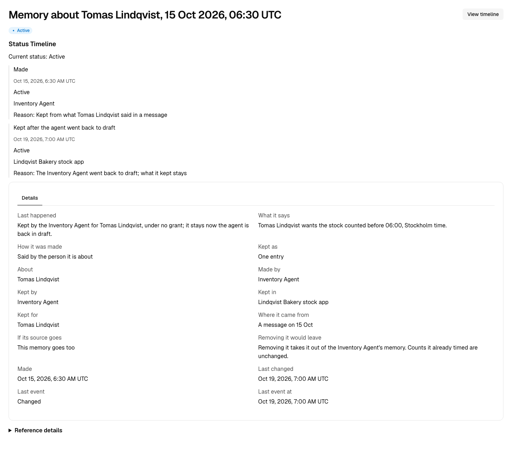
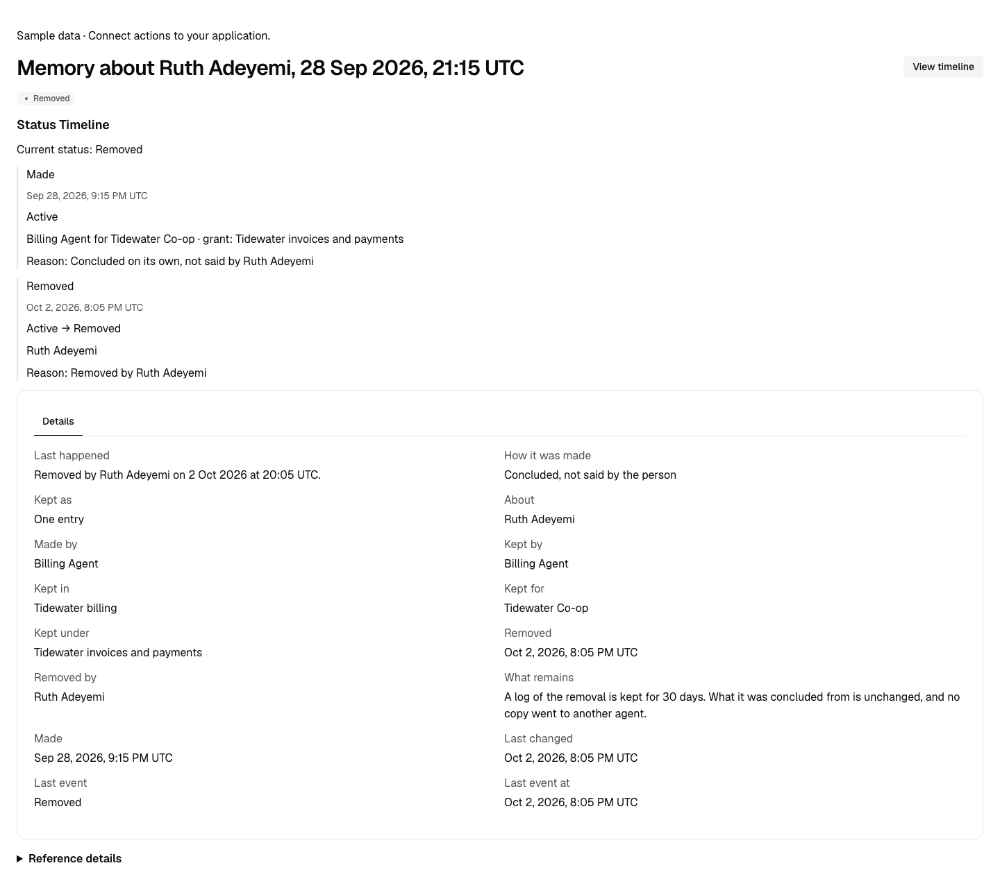
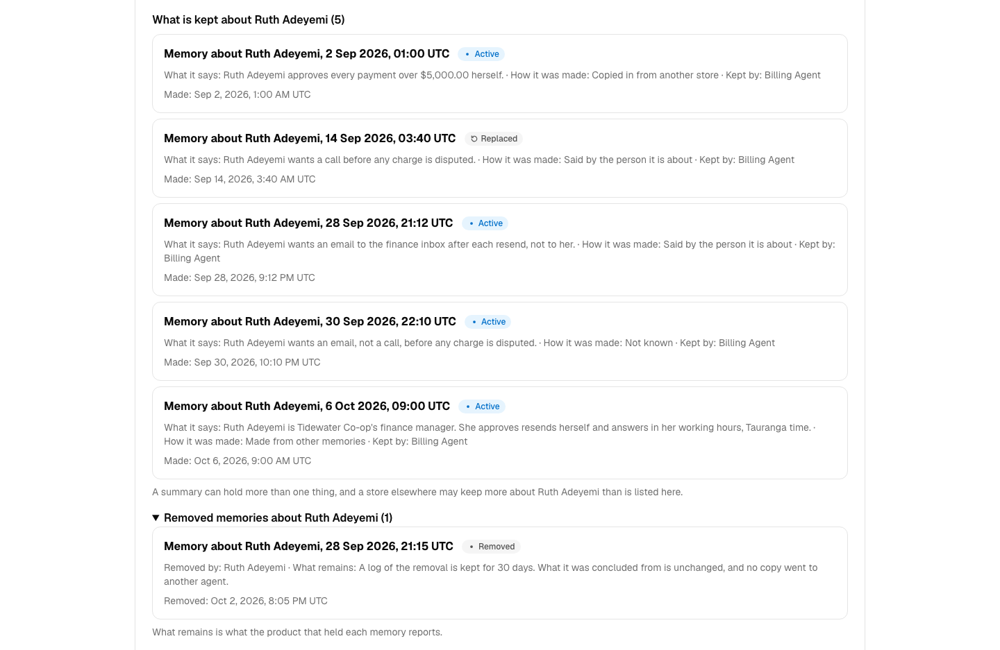
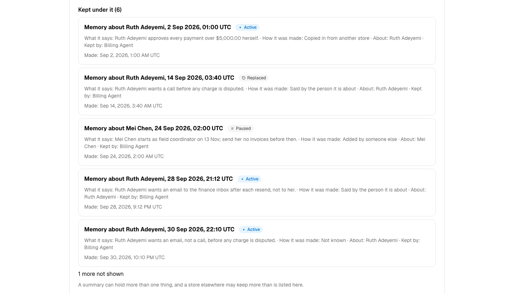

# Memories as claims

**A memory is a claim, not a fact.** Removing a memory removes the entry, not what it shaped.

What does an assistant or an agent keep about a person, and what can that person see of it? In OODS Foundry a
**memory** is what an assistant or an agent keeps about a person, which may be what the person said or what it
concluded on its own. It is a claim, not a fact: its page says how it was made, who made it and who keeps it, for whom
and under which grant, and what removing it would leave, each as the product that holds it reports. It is an object of
its own, `Memory`, and its facts live on a trait, `Remembered`, so your own memory records can take them too.

A memory is read-only in OODS Foundry. The memory lives in your product's own store, which writes these records; OODS
Foundry models and shows them.

## What one memory is

- **One memory is what its holder can remove by itself,** as your product shows it: one entry, a summary or a file ("Kept
  as"). A summary is one memory, however much it holds, and OODS Foundry never splits it into facts.
- **Its name is who it is about and when it was made:** "Memory about Ruth Adeyemi, 28 Sep 2026, 21:12 UTC". The time
  keeps two memories made the same day apart. The name never comes from what the memory says, so a record that points at
  a memory, a history line and a grant's last use all name it without repeating its words.
- **Its words appear only where the memory itself is shown:** its own page and card, and the rows of the lists that show
  it.
- **It gives no authority.** A habit a memory records never stands in for a yes: that is a grant's or an approval's work.

## How it was made

A memory's page, its card and its row on every list of what is kept say how it was made; a removed memory's row says
instead who removed it and what remains. The words are in the third person, because every page is drawn the same for
everyone.

| Your product stores | The page shows |
|---|---|
| `told` | Said by the person it is about |
| `inferred` | Concluded, not said by the person |
| `combined` | Made from other memories |
| `imported` | Copied in from another store |
| `added_by_someone_else` | Added by someone else |
| nothing | Not known |

A store that does not say how a memory was made never reads as something the person said.

## Four states

| State | What it means | Moves to |
|---|---|---|
| Active | Kept and used | Paused, Replaced, Removed |
| Paused | Kept and not used | Active, Replaced, Removed |
| Replaced | A newer entry took its place | Removed |
| Removed | The product that holds it reports it removed | Nothing: removed is final |

- **A correction is a line, not a state.** So are the person's own statement and a rewrite by a model that no one asked
  for. Each line names who acted and when, and none holds the memory's words, old or new.
- **An expiry is a reason, not a state.** One that hides the memory is a pause, at its expiry; one that removes it is a
  removal by time.
- **No state takes a success colour.** Active is the information tone, and Paused, Replaced and Removed are neutral.

## A removed memory

A removed memory holds no words, no note on its source and no statement from the person, and its page shows none of them
even where a product still sends them. Its page says who removed it and when, and "What remains": what the product that
held it reports is left, or "Not reported" where it says nothing. While a memory is not removed, "Removing it would
leave" says the same in advance, or "Not reported".

**Removing a memory removes the entry, not what it shaped.** An email it shaped stays sent, and a summary made from it
keeps its own words until that summary is removed too.

## Under a grant

- **Keeping notes is an act like any other.** An agent keeps a memory for a party only under a grant whose go-ahead lines
  name it: the Billing Agent's and the Tidewater grant's read "Keep notes about the people it deals with". Under a
  grant's rule, anything no line names never happens ([Grants as standing yeses](grants-as-standing-yeses.md)).
- **Each memory an agent makes under a grant is a use of it.** The Tidewater grant counts the five the Billing Agent made
  among its 11 uses, and its last use can be a memory, read by its name: "6 Oct: kept Memory about Ruth Adeyemi, 6 Oct
  2026, 09:00 UTC". A memory someone else added, or a file copied in, is kept under the grant without being one of its
  uses.
- **Taking a grant back ends the yes, not the memory.** The grant's page keeps listing what was kept under it.
- **An agent acting for its own sponsor acts under no grant,** and its memories name none.

## Where a person sees it

- **A person's page** lists "What is kept about {name}", each row with what it says, how it was made and who keeps it,
  and when it was made. Below it, closed until opened, "Removed memories about {name}" lists each removed one with who
  removed it, what the product reports remains, and when.
- **An agent's page** lists "What {name} keeps", and **a grant's page** "Kept under it".
- **An organization's page lists no memories.** There is no viewer, so a list of its members' memories would be an
  administrator's view drawn for anyone.
- **Under its rows,** the person's list says "A summary can hold more than one thing, and a store elsewhere may keep more
  about {name} than is listed here."; the agent's and the grant's say the same without "about {name}"; the removed list
  says "What remains is what the product that held each memory reports."

[The person's side](the-persons-side.md) has every list on these pages and what each cannot see.

## The example

Times are UTC, as the records keep them. Ruth Adeyemi and Mei Chen are in Tauranga (UTC+12 until 27 September, then UTC+13), and Tomas
Lindqvist in Gothenburg (Stockholm time, UTC+2 until 25 October).

**Ruth Adeyemi, the Billing Agent and the Tidewater grant.**
- **28 Sep, 21:12 (29 Sep, 10:12 in Tauranga).** In a chat, Ruth tells the Billing Agent how she wants to hear about
  resends. It keeps what she said: "Said by the person it is about", from "A chat on 28 Sep", kept under Tidewater
  invoices and payments and kept for Tidewater Co-op.
- **28 Sep, 21:15.** On its own, it also keeps something it concluded from how she answered an approval: "Concluded, not
  said by the person".
- **2 Oct, 20:00 (3 Oct, 09:00 in Tauranga).** She corrects the first: "Ruth Adeyemi wants an email to the finance inbox
  after each resend, not to her." It stays active, with one more line, "Corrected by Ruth Adeyemi", which holds no words.
- **2 Oct, 20:05.** She removes the second. Its page now says she removed it then, and what Tidewater billing reports
  remains: a log of the removal is kept for 30 days, what it was concluded from is unchanged, and no copy went to
  another agent.
- **6 Oct, 09:00.** The Billing Agent makes its one summary about Ruth from its other memories about her ("Made from
  other memories"). On 20 Oct at 03:00, Tidewater billing's nightly summary rewrites it, a line by the system that says no one
  asked.
- **Where she sees them.** Her five memories that are not removed, these two and three older ones (a notes file copied in
  on 2 Sep, a memory from 14 Sep and the one that replaced it on 30 Sep), are on her page under "What is kept about Ruth
  Adeyemi", the removed one below them, and the same five, with Mei Chen's, on the Billing Agent's page and under the grant.

**Tomas Lindqvist and the Inventory Agent, under no grant.**
- **15 Oct, 06:30 (08:30 in Gothenburg).** Tomas tells his own Inventory Agent to count stock before six. It keeps "Tomas
  Lindqvist wants the stock counted before 06:00, Stockholm time", kept for Tomas, under no grant: the agent acts for its
  own sponsor.
- **19 Oct.** He takes the agent back to draft. The memory stays, and the agent's page still lists it.

### What a product's own record of a removal might hold

An example, not a sample: OODS Foundry ships no such record. A memory's page shows what remains as one sentence, the
product's report; a product that keeps a fuller record of a removal keeps it itself.

| What the record holds | For Ruth's removed memory |
|---|---|
| The entry | Removed on 2 Oct 2026 at 20:05 UTC, by Ruth Adeyemi |
| What it was concluded from | An approval, unchanged |
| A log of the removal | Kept for 30 days, until 1 Nov 2026 |
| Copies | None went to another agent |
| A receipt | Emailed to Ruth Adeyemi at 20:10 UTC |

## What OODS Foundry does not do

- **It stores no memory, removes none, tells no one and checks nothing.** Your product's store writes these records, and
  OODS Foundry shows them.
- **It says nothing a product does not report.** How a memory was made is the product's value, shown in OODS Foundry's
  words for it, or "Not known"; what removing it would leave and what remains are the product's own words, or "Not
  reported".
- **It offers no Edit, no Delete and no move.** Memory composes no form and so no workflow. The person's own controls,
  to correct, stop using, remove or add a statement, are your product's.
- **No viewer.** A page is composed the same for everyone; nothing is shown or hidden by who looks.
- **Lists read ids.** A memory that names a person only in words, or that another product keeps, is not listed.
- **Times are shown in UTC,** and every date-time a page shows says so.
