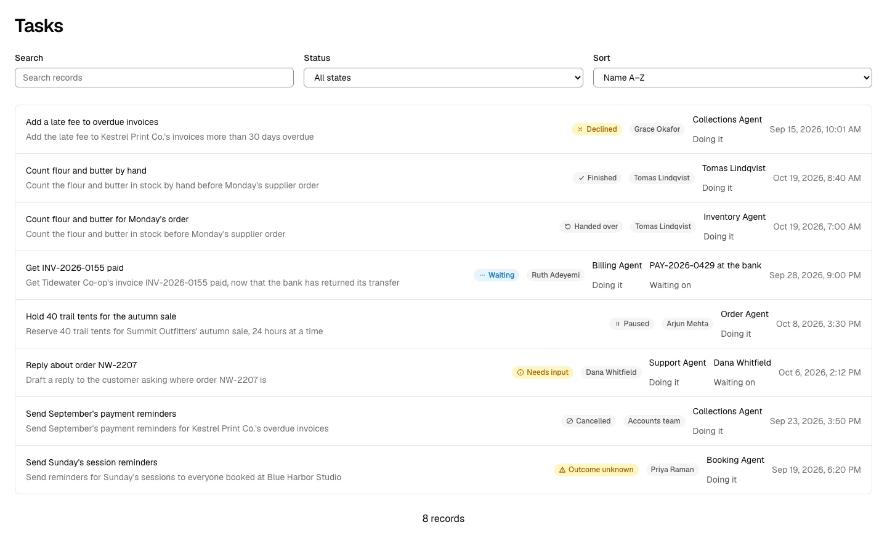
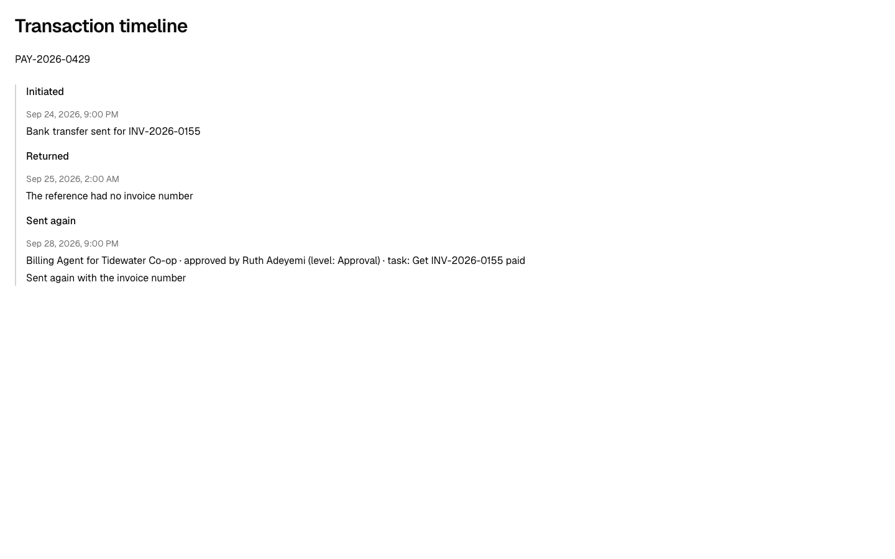
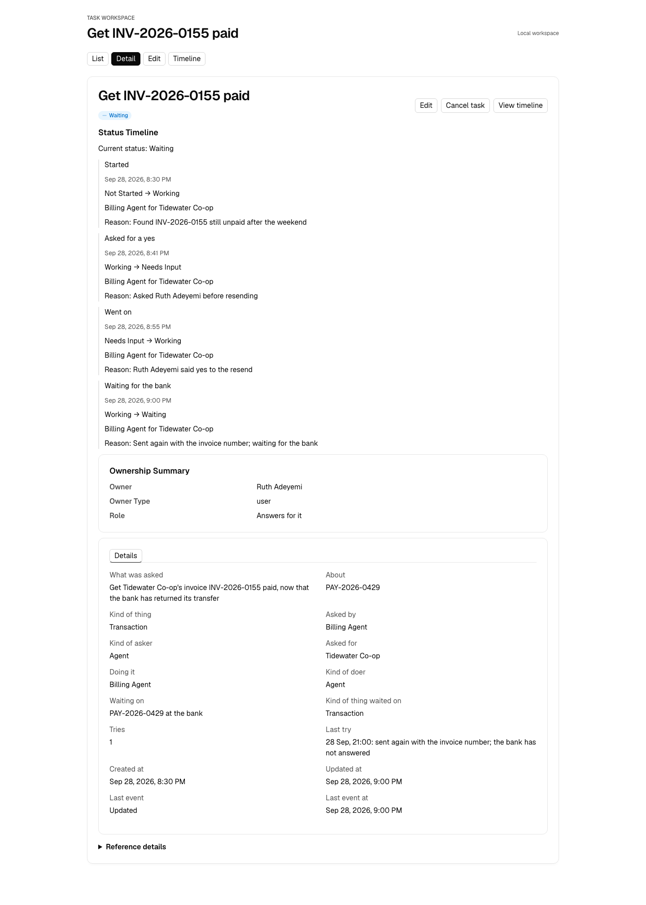

# Tasks as asks

When an agent is working on something in your product, what is that work, and what does a person see of it? In OODS Foundry a task is **an ask, not a ticket**: one ask to one person or agent to do one piece of work, and what became of it. It is an object of its own, `Task`. Its facts live on a trait, `Assignment`, so your own records of work can take them too. The ticket, issue, invoice or payment the work is about stays your own object, and the task points at it.

## Four layers, and the one OODS Foundry models

- **The thing**: a ticket, an issue, a case, an invoice, a payment. It lives long, changes hands and stays your product's own object. One thing can have many tasks over its life, by people or agents, at once or in a row.
- **The conversation**: a chat or a thread, where asks are made. One conversation can hold many tasks, or none. It is not modelled.
- **The task**: one ask to one actor. This is what `Task` models.
- **The try**: a run, a session or an attempt, one go at the task. A task can take several and still be one ask. A try is counted on the task, not kept as a record of its own.

A to-do is a task whose asker, doer and the one who answers for it are one person.

## The object and its traits

`Task` composes five traits:

| Trait | What it gives a task |
|---|---|
| `Assignment` | The record's facts: who asked and for whom, who is doing it, exactly what was asked, what the work is about, when it is due, what it waits on, the task it came from and the first ask in its chain, the result in one line, and the number of tries with the last one's line. |
| `Stateful` | The state of the work, as a lifecycle with a declared order (below). |
| `Timestampable` | When it was created and last changed. |
| `Ownerable` | The one who answers for the work: a person or a team, never an agent. |
| `Cancellable` | Cancel, with a reason. |

**One ask to one actor.** That is the grain of an approval, which is one ask to one actor for a yes; a task asks for work. What was asked is written once: a changed ask is a new task. Handing the whole of the work on ends the task and starts another; asking for help with a part starts another while the first waits (below). One object serves whether a person or an agent does the work: the doer's kind is a fact about the doer.

**No field says what the doer may do.** A task holds no grant, scope or budget. The doer acts under its own authority, which lives on its own record: a person's account and roles, an agent's rules and any grant it holds from the one the work is for.

## Four seats, and no assignee

| Seat | Who can sit in it |
|---|---|
| **Asked by** | A person, an agent handing work on, or an agent that started the work itself. |
| **For** | The person or organization the work is done for. Never an agent. It stays the same down a chain of helpers. |
| **Doing it** | One actor, a person or an agent, written once. |
| **Answers for it** | A person or a team. Never an agent. |

**Who answers, by rule.** A person doing the work answers for it. When an agent is doing it and a person asked, the person who asked. When an agent is doing it and no person asked, because it started the work itself or another agent asked, the sponsor of the agent doing it. The case people disagree on is one agent asking another; OODS Foundry's choice is the doing agent's sponsor, not the asking agent's. Your product writes the name, and nothing checks it.

There is no seat called assignee, because the word now means two things. In some products the assignee is the one doing the work; in others it is the one who answers for it while an agent does the work. With people those were one person, so one field did. An agent can do the first and not the second.

The one who answers is the task's owner, through `Ownerable`, with the role "Answers for it". The screens call it "Owner" and the detail page's panel "Ownership Summary"; on a list row the owner's name has no role beside it, so the one doing the work is shown as a value over its caption, "Doing it", to keep the two apart. The seats keep their names after the work ends: on a finished, declined or handed-over task, Doing it still names the one who was asked to do it, and the badge and the result say how it ended.

## Eleven states

| State | In plain words |
|---|---|
| Not started | It exists. The doer has not begun. |
| Working | The doer is on it. |
| Needs input | It cannot go on until a named person gives a yes or an answer. |
| Waiting | It cannot go on until something else happens: another actor's task, or the outside world. |
| Paused | A person put it on hold, and only a person lifts it. |
| Outcome unknown | The doer acted and does not know whether it took. |
| Finished | The doer says it is finished. |
| Failed | The doer could not do it. |
| Declined | The doer would not do it, or may not. |
| Cancelled | A person stopped it. |
| Handed over | It ended here, and goes on as a new task with another doer. |

The last five are endings. `Task` declares the order of its states, with the endings final (empty lists): by the order, a finished or cancelled task never moves again, and a second ask is a second task. Your product enforces this order. OODS Foundry keeps it as data and moves no task. It holds its own sample tasks to the order and, in generated React and Vue screens, offers Cancel, and the generated store accepts it, only from a state the order lets move to cancelled. Any other change goes through, including one made with the status select.

**A wait is the task's own state, with a pointer.** "Needs input" and "Waiting" are two states because a person scanning a list needs to know first whether a person is needed. Each names what it waits on: a person, an approval, another task, or something outside such as a payment at the bank. The task's state is its own: an approval can be answered while the task still says it needs input, and that disagreement is worth seeing.

**States that belong to something else** stay there: approved is an approval's, and pending and settled are a payment's. Two words appear on both sides and mean different things. An approval's declined is a person's no to an ask for a yes, where a task's Declined is the doer refusing the work. A paused agent is a state of the agent, where a task's Paused is a person holding that one task. Late is not a state either: it follows from the due date, and your product works it out.

## Finished and accepted

Finished is the doer's word, and a state of the task. It takes no success colour. Accepted is someone else's yes about the result, and that is an [Approval](approvals-as-decisions.md), never a state of the task. The result itself, such as a payment or an article, is a thing of its own; the task keeps one line about it in the doer's words. Accepting a result through an approval that names its task is the model; this release does not wire it.

## Tries and unknown outcomes

**A try is a number on the task, and one kept line saying how the last one ended**, such as "28 Sep, 21:00: sent again with the invoice number; the bank has not answered". It is not an object, and not a line in the task's history: an attempt is not a change of state.

**An unknown outcome is a state.** The next step differs from a failure's: after a failure, try again; after an unknown, find out first. Filed under failed, it reads "it did not happen", and the money goes twice. The Booking Agent's reminders are a sample: the text-message service sent no delivery report, so the task says outcome unknown and nothing was sent again.

## Handing work on

There are two kinds of hand-off, and neither is a record of its own.

- **Asking for help with a part.** The first task waits, pointing at the helper's task.
- **Handing over the whole.** The first task ends as handed over, and its last line says to whom.

Either way the new task is the record. It holds who asked (the first doer, or the person taking over), for whom (unchanged), who is doing it, exactly what was asked, the task it came from, and the first ask its chain began with. It holds nothing about authority: the helper acts under its own grant, or does not act.

**The trace back.** Each change in any record's history can name the task it was made under; each task names the one it came from and the first ask. The first ask's name is kept on every task in a chain, so a search by it gathers the chain on the Task list. When an agent started the work itself, there is no first ask on record: the chain begins at the agent's grant, the delegation from the one the work is for, whose own history names who gave it. The task keeps no pointer to the grant.

## The history line names its task

A change made as part of a task can say which task it was, through two optional fields on a history entry (`Stateful`'s `state_history`, `Auditable`'s `audit_log`):

| Field | Holds |
|---|---|
| `task_id` | the Task the change was made under |
| `task_name` | the task, as shown |

Every history in OODS Foundry prints the task after who acted and who approved: **Billing Agent for Tidewater Co-op · approved by Ruth Adeyemi (level: Approval) · task: Get INV-2026-0155 paid**. The task's id stays in the record's data. It is a pointer, not a link: a generated app holds one object's records, so the line cannot open the task. An entry without the two fields prints exactly as before.

## The example

The Billing Agent's task was to get INV-2026-0155 paid after the bank returned Tidewater Co-op's transfer. Nobody gave it that task: it started the work itself, under the grant from Tidewater Co-op. It is for Tidewater Co-op, the Billing Agent is doing it, and Ruth Adeyemi answers for it, as the agent's sponsor.

Times here are UTC, as the records keep them; Tidewater Co-op is in Tauranga, New Zealand. The bank returned the transfer early on Friday 25 September. The task starts on 28 September at 20:30, Tuesday morning in Tauranga, shortly before the agent asked Ruth Adeyemi for a yes: nothing in the records says anyone was on the returned transfer in between, and a task record is what makes that gap visible. When it asked her, the task needed input. When she said yes it went on. Her yes is used once, by the resend, so the task's line says only that she said yes, and the payment's line names her approval, its level and the task. After the resend it waits on the bank, with one try made. It is not finished, because pressing send is not the work.

Three records say three things, and none is wrong: the approval is used, the payment is pending, and the task is waiting. If the bank settles, the task is finished. If the bank returns it again, the task is working again, and a second resend needs a second yes. If nobody can tell whether the resend went out, the outcome is unknown, and nothing is sent again until someone finds out.

## What a person can do to a running task

- **Cancel** stops what has not happened. It undoes nothing, and it is a request: the record can say cancelled while the last step still went through. An approval the task was waiting on is withdrawn by your product, not by the cancel.
- **Pause** holds it. A step already under way may finish; nothing new starts.
- **Redirect.** A small steer is not kept on the task: it is not a change of state, so it has no line in the task's history, and the ask stays as written. A changed ask is a new task, because the result would otherwise be judged against an ask that was rewritten.
- **Take over** is a hand-over to a person: the agent's task ends as handed over, the person's own task starts, asked by them, and what the agent changed stays, under its name. A yes it asked for and did not use is not the person's to use.

None of these undoes a change already made.

## Where limits live

What the doer may touch is on its grant and its own rules (see [Agents as actors](agents-as-actors.md)). A task narrows that by naming one thing; it never widens it. A deadline belongs on the task, as its due date. A budget is not modelled anywhere yet.

## Bringing your own records of work

`object_import` proposes `Assignment` for another system's record of work where the schema carries the evidence: a state with a working value, a finished value and a value that means a person is needed, and a reference to the one doing the work, either an agent's own record or a person the schema names as doing it, such as an assignee. Either alone proposes nothing, and nothing is applied without your acceptance. Linear's agent session is recognised. An agent protocol's own task record, such as A2A's or MCP's, names no one, so it gains nothing: it keeps the states its protocol gives it. A tracker's issue usually does not match, which is right: it is the ticket. [IMPORTING-OBJECTS.md](../../packages/foundry/IMPORTING-OBJECTS.md) has the rule and how other systems' states read against a task's.

## What OODS Foundry does not do

It models and renders. It does not run, retry, pause or expire work, and its Cancel action records that a person asked to stop: it stops nothing. No ending is enforced outside Cancel: a task's status select offers every state, and a generated app saves whatever a person picks there. Beyond that:

- Cancel follows the declared order in generated React and Vue screens only. An HTML screen offers it whatever the state.
- A task's form also offers fields a person would not edit there: the task's own id, the owner's id, type, name and role, the last event and when it was created.
- On a task's, a thing's or an agent's own page it cannot list the tasks that belong to it: a task's helpers, a thing's tasks, an agent's tasks. The Task list's search finds them by name. It cannot show a signed-in person "waiting for you".
- The try count, what a task waits on, the first ask's name and who answers are kept by your product and checked by nothing.
- Accepting a result through an approval that names its task is the model, and is not wired.
- A line a generated app writes when a person changes a task names no one.
- A team's own object named Task replaces the shipped one, and importing A2A's schema drafts an object named Task.
