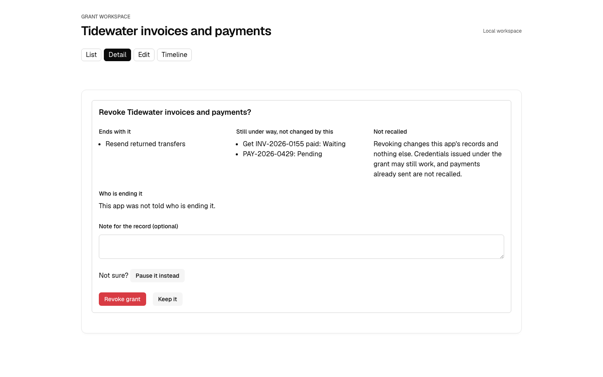
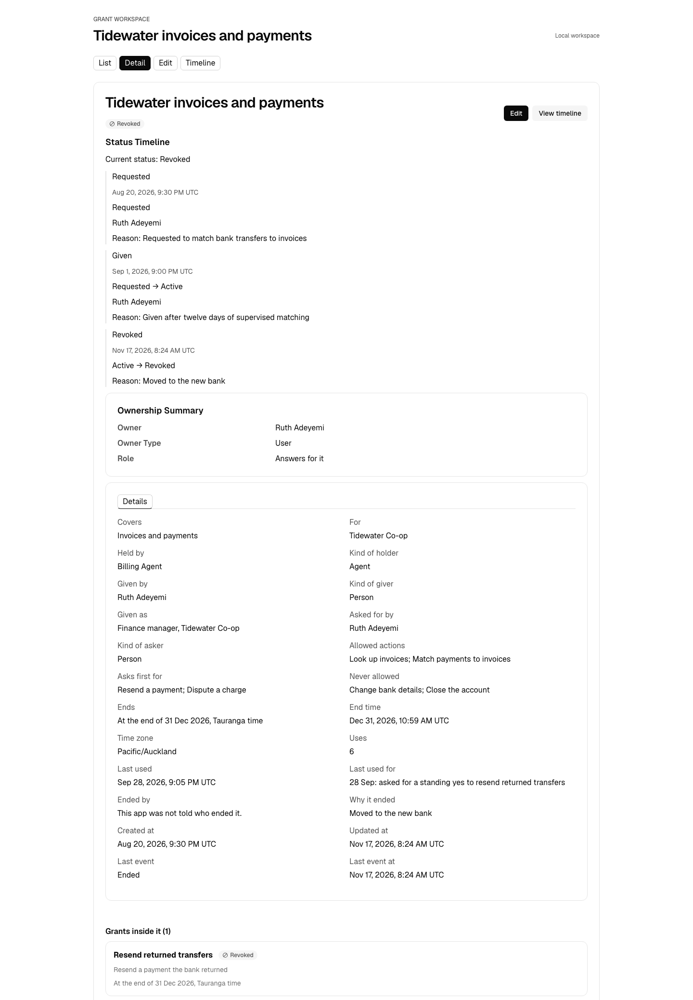

# The person's side

> **The Grant story has three parts.** [Grants as standing yeses](grants-as-standing-yeses.md): what a grant is.
> [The person's side](the-persons-side.md): where a person sees their grants, and takes one back.
> [What became of the work](what-became-of-the-work.md): what a product reports after a grant ended.
> Taking a grant back ends the yes, not the work.

**Taking a grant back ends the yes, not the work.**

When someone gives an agent a standing yes, where do they see everything they gave, and what happens when they take one back? In OODS Foundry a person's, an organization's and an agent's own pages list the records that point at them, by the seat each record names them in ([the seats](grants-as-standing-yeses.md#the-seats)), and a grant's page lists the records here that name it. In a generated app a grant can be revoked, paused and resumed. A revoke asks once first, saying what ends with it and what goes on, and the grant's page then shows what was still under way when it ended.

## The four pages

Each page ends with its lists, after the record's own panels. A list reads the records that point at its subject by id, never by name, and it is declared on the object whose page shows it (`metadata.relatedLists`, in [your own objects and traits](../../packages/foundry/OBJECTS-AND-TRAITS.md#related-lists)). On a person's, an organization's and an agent's page, the headings name the subject. No page speaks to the person it lists as "you" (there is no "waiting for you"): there is no viewer, so every page is composed the same for everyone.

| Page | Its lists, in order |
|---|---|
| A person (`User`) | Waiting for {name}'s answer: the approvals asked of them, the tasks that need their input and the grants asked of them, by due date, then oldest. Agents holding a grant for {name}. Given for {name} by someone else, the ones that stand. Grants {name} gave. Grants {name} answers for. Agents {name} sponsors. What {name} approved. Ended grants {name} gave, and Ended grants given for {name} by someone else, each closed until opened. Closures {name} answers for. Closures of grants for {name}. |
| An organization (`Organization`) | Grants asked for {name}, not yet answered. Agents holding a grant for {name}. Recorded on behalf of {name}. Tasks for {name}. Approvals for {name}. Payments for {name}. Ended grants for {name}, closed until opened. Closures of grants for {name}. |
| An agent (`Agent`) | Grants {name} holds. Work {name} did. Ended grants {name} held. |
| A grant (`Grant`) | Grants inside it. Replaced by. Recorded under it, beside your product's own count of uses. Still under way. Recorded after it ended, and Its closure, each shown once it has ended. Its parties now. |

A row is read-only and never a link. It shows the record's title and state, a one-line summary and a time, and under a grant, the grants inside it; the record's history lines open in a disclosure. A list shows its first five rows and counts the rest ("2 more not shown"). On a person's page, "Agents holding a grant for {name}" and "Grants {name} gave" say under their rows where to end a grant: "This list does not change grants: revoke one on the grant's own page." "Given for {name} by someone else" also says who should: "This list does not change grants. Only someone who may give grants for {name} should end one, on the grant's own page; this app does not check who is asking." A grant's own page is its detail screen, opened from the Grant list.

**What each page cannot see.** Under its lists, every page has one note. A person's, an organization's and an agent's page say: "These lists show only records here that name {name} by id; records that name {name} only in words, or that another product keeps, are not listed." A grant's page, whose "Its parties now" looks its parties up by the ids the grant holds, says: "These lists show only records here, matched by id; records named only in words, or that another product keeps, are not listed." An organization's page adds: "Subscriptions, usage and invoices name their customer in words, so they are not listed here." In a generated app, the records of other objects are copied from the samples when the app was made, and the page says so once; the app's own records are its store's, so a change made there shows at once. Replace `relatedRows` in the generated `src/store.ts` with your own query.

## Revoke, Pause and Resume

`Grant`'s lifecycle declares three moves a person makes (`Stateful`'s `actions`, in [your own objects and traits](../../packages/foundry/OBJECTS-AND-TRAITS.md#lifecycle-actions)):

| Action | From | To | What it records |
|---|---|---|---|
| Revoke | active or paused | revoked | the event ended; the note, when given, as why it ended; who ended it, when the app is told |
| Pause | active | paused | the event paused |
| Resume | paused | active | the event resumed |

A grant's page offers each only from the states it moves from, alike in React, Vue and HTML: a revoked or replaced grant offers none of them. A grant has no Delete: an ended grant is kept. In static HTML a button changes nothing and says so: "Revoke grant needs your application to act. Nothing was changed."

**In a generated app, Revoke asks once.** Moving the status to revoked on the grant's form is the same Revoke, asked the same way. The question's heading and its button name the act: "Revoke Tidewater invoices and payments?", with "Revoke grant" and "Keep it". One screen says, from the records:

- **Ends with it:** the grants inside it, by name.
- **Not ended with it:** a grant inside it that is still only asked for, named with "Asked for and not yet answered, so it does not end with this one. Answer it on its own page."
- **Still under way, not changed by this:** the records whose own lines name the grant and that are not final, or not known, each with its state, leaving out what ends with it.
- **Not recalled:** "Revoking changes this app's records and nothing else. Credentials issued under the grant may still work, and payments already sent are not recalled." Your product may replace this sentence with its own.
- **Other grants still held for this party:** the other grants its holder holds for the same party, shown only when there are some.
- **Who is ending it:** the person the app was told of, or "This app was not told who is ending it."

A note for the record is optional. Asked from an active grant's Revoke button, the question also offers a pause, which Resume undoes: "Not sure? Pause it instead." Asked from the form, it does not, since the form's other changes would go unsaved. Focus moves to the heading when the question opens, Escape keeps the grant, the Revoke button is never focused first, and nothing times out. The result stays as a status message until the person moves on.

**Pause asks nothing,** and its result says how to resume. **Resume gives the grant again,** so a paused grant's page says who should: "Only someone who may give grants for Tidewater Co-op should resume this grant; this app does not check."

A move the lifecycle declares no action for (to expired, replaced, declined or withdrawn, or a requested grant given) saves as an edit, from the form's status select or from your product: its line is titled with the new state, and its reason says what was edited ("Edited Status").

## What a revoke records

- **The grant:** its state, revoked; the note, if one is given, as why it ended; one line titled "Revoked" with the note as its reason; and its last event, ended, with the time.
- **Who acted:** a generated app is told who is acting by your product, `createWorkflow({ actor: { id, name, kind } })`. Then every line the app writes names them, including a Cancel's and an edit's on objects that have them, and Revoke writes them as who ended it. Told no one, a line names no one, and the grant's page says "Ended by: This app was not told who ended it." The app never asks anyone to type their own name, and never writes the capacity they ended it in (`ended_as`): your product does, where the one who ended it holds none of the grant's seats.
- **The grants inside it** end with it at the same instant, each with its own line: "Ended with Tidewater invoices and payments".
- **Once a grant has ended,** why and by whom it ended stay as they were recorded: the app refuses a change to either, and the form shows why it ended as a fact. Its name still saves.

## The declared order is kept

`Approval`, `Task` and `Grant` declare the order of their states. A generated app keeps it in its own store: the status select offers the record's state and the moves the order allows from it, and the store refuses any other move, in plain words: "This grant's status is Active; from there it moves only to Paused, Revoked, Expired or Replaced." A move out of an ending is refused too: "This grant's status is Revoked, and that status is final." An object that declares no order saves as before.

## What became of the work

A grant's "Still under way" lists the records whose own lines name the grant and that were not final, or not known, when it ended, with their state then and now. It never calls them closed, stopped or done.

Dana Whitfield revoked Northwind customer replies on 8 October 2026: "Replies go back to the support team." The task it was used for, "Reply about order NW-2207", still needed her answer, and it still does. The grant's page lists that task as still under way: "When the grant ended: needs input. Now: needs input." Below it: "These are only the records here that name this grant; work under it elsewhere is not shown." Taking the grant back ended the yes. The work is the task's, and it goes on. What a product reports became of it is a closure, the third part of the story: [What became of the work](what-became-of-the-work.md).

## What OODS Foundry does not do

- **No viewer.** A page is composed the same for everyone; nothing is shown or hidden by who looks, and no page speaks to the person it lists as "you".
- **It stops nothing.** A generated app's Revoke, Pause and Resume change the app's own records when a person asks. Your product stops tokens, withdraws approvals, and pauses or hands on tasks.
- **It counts nothing.** A grant's uses are your product's count, shown beside the records here that name the grant; the two need not agree.
- **Lists read ids.** A record that names the subject only in words, or that another product keeps, is not listed. In a generated app, other objects' records are copies from the samples.
- **Times are shown in UTC,** and every date-time a page shows says so, as a form's date-time input does in its label. A page in its subject's own zone is not built yet.
- **What was done about the work still under way when a grant ended** is your product's report, recorded as a closure ([What became of the work](what-became-of-the-work.md)); OODS Foundry writes none and stops nothing.
