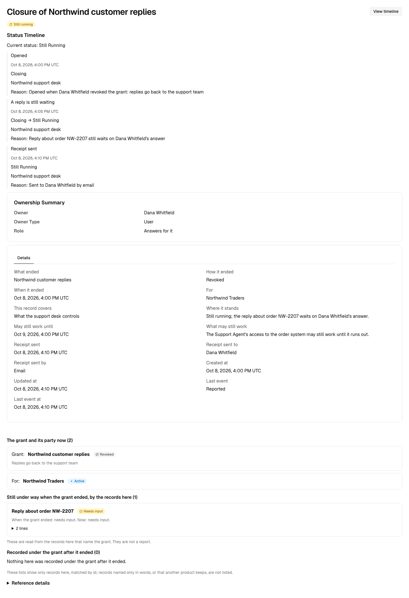
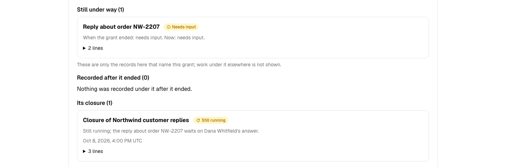
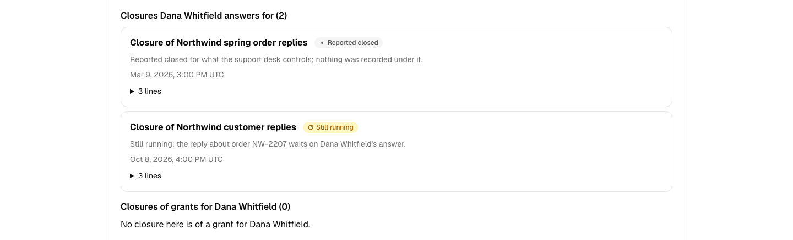

# What became of the work

> **The Grant story has three parts.** [Grants as standing yeses](grants-as-standing-yeses.md): what a grant is.
> [The person's side](the-persons-side.md): where a person sees their grants, and takes one back.
> [What became of the work](what-became-of-the-work.md): what a product reports after a grant ended.
> Taking a grant back ends the yes, not the work.

This is the third part of the Grant story. When a grant ends, the yes ends at once; the work done under it does not.
Tasks may still wait, payments may still be on their way, and access already given may still work for a while. In OODS
Foundry, what became of that work is a record of its own, a **closure**: what a product reports after a grant ended,
line by line, each line naming who reported it. Only a report should move a closure, a rule your product keeps, and none
reads "Closed": the nearest it comes is "Reported closed".

## A closure, and which endings get one

`Closure` is the sixteenth public object. It composes the `Closeout` trait (the facts), `Stateful` (its five states
and their order), `Timestampable` (opened, reported and updated) and `Ownerable` (the one who answers for it, a person
or a team, as for the grant).

A product opens one closure for each grant that was **given and then ended**: revoked, replaced, or expired after it
was given. A request that was declined, withdrawn or left to expire was never given, so it gets none. A grant that ended
with its outer grant gets none of its own: your product may name it, in words, in a line of the outer grant's closure.

A closure is read-only in OODS Foundry. It composes a list, a detail page, a timeline, a card and an inline view, and
no form, so its page offers no Edit, no Delete and no move, and no app is generated for it. A product writes its
closures from reports.

## Five states, and their order

A badge prints the state's own name, so the claim is in the name: a closure reads "Reported closed", never "Closed".

| State | What it says |
|---|---|
| Closing | Asked to stop. Answers are awaited. |
| Reported closed | Nothing more can start under the grant, as reported, for the stated scope. Never drawn as a success. |
| Still running | Something named is still going, or may still work until a stated time. |
| Not known | No report says. Never read as closed. |
| Failed | A report says something that had to stop did not. |

A closure opens closing, when its grant ends. A report moves it to reported closed, still running, not known or failed;
from still running or not known it moves on as later reports say. Reported closed moves again only to failed, on a
report that something that had to stop did not. Failed is final: what is done about it afterwards is a line on the
failed closure, never a rewrite of it.

## Only a report should move it

Time and silence close nothing. A product may set a deadline (`deadline_at`, "Waits for answers until"), and when it
passes with no answer the product may say so in a line of its own. That line reports only that nothing is known: it may
move a closure to not known, never to reported closed and never to failed. The declared order cannot tell a deadline
line from any other report, so no check holds this rule; your product keeps it. On your own object that composes
`Closeout` and has a form, the status can be changed there, so there too the rule is your product's to keep.

**A line** is an entry in the closure's history: its title, the instant, the reason, and who reported it, by name and
kind (person, agent or system), with their id where they are a record here. Most lines are a product's own system's.
A line either moves the closure's state or reports without moving it: a party told, a party's answer, a piece of work's
fate, the receipt sent. A line that keeps the state is written as a generated app writes an edit's line, `from: null`
with `to` the state it stands in, so the status timeline prints its title and that state, never a move to itself.

## Who was told, the window, and the receipt

- **Who was told, and what each answered,** are lines, each with its instant, since a field cannot hold several
  parties each with their own time.
- **The window:** until when access already given may still work, as an instant (`still_works_until`, "May still work
  until") or in words (`still_works_note`, "What may still work"), "Not known" among them.
- **The receipt** is sent outside the page by your product, and recorded inside it: when (`receipt_sent_at`), to whom
  (`receipt_sent_to_name`) and how (`receipt_channel`), with a line of its own. The closure's own page is the receipt's
  content: OODS Foundry's tools draw the samples, so your product draws its own closure record with the generated
  components, and sends the result.

## What the records here show, beside what was reported

A closure's page shows its lines, who answers for it and its facts, then three lists:

- **The grant and its party now:** the grant and the party it was for, each as it stands now, by id, or by the name the
  closure keeps where it is no record here.
- **Still under way when the grant ended, by the records here:** the records whose own lines name the grant and that
  were not final, or not known, at the instant the grant ended, each with its state then and now. Under it: "These are
  read from the records here that name the grant. They are not a report."
- **Recorded under the grant after it ended.**

The second and third lists read the grant's end from the closure's own `ended_at` (`endedAt`, in [your own objects and
traits](../../packages/foundry/OBJECTS-AND-TRAITS.md#related-lists)), never the closure's own state. Below the lists,
one note says: "These lists show only records here, matched by id; records named only in words, or that another product
keeps, are not listed."

**Where else a closure shows.** A grant's page lists "Its closure" once the grant has ended, with the closure's lines
in its row, or says "No closure here is of this grant.", as every ending that gets none by rule does. A closure is
listed on the page of the person who answers for it, under "Closures {name} answers for", and on the page of the party
the grant was for, a person or an organization, under "Closures of grants for {name}".

## The example

**Dana Whitfield's take-back, as the samples hold it.** Dana Whitfield revoked Northwind customer replies on 8 October
2026 at 16:00 UTC: "Replies go back to the support team." Northwind's support desk opened its closure at that instant,
closing. Five minutes later it reported that "Reply about order NW-2207" still waits on Dana's answer, which moved the
closure to still running; at 16:10 it sent Dana a receipt by email, a line that keeps the state. Its window: the
Support Agent's access to the order system may still work until it runs out, at 16:00 UTC on 9 October.
Beside what was reported, the records here show the same task, "When the grant ended: needs input. Now: needs input.",
and nothing recorded under the grant after it ended.

The other two closures rest in reported closed (Northwind spring order replies: nothing was recorded under it, and the
support desk reports nothing more can start under it) and not known (Marlow Yoga class bookings: the booking service
was told and did not answer by the front desk's deadline).

**What a product would record if Ruth Adeyemi took the Tidewater grant back.** This half is an example, not a shipped
sample. Suppose Ruth Adeyemi revokes Tidewater invoices and payments on 30 September 2026 at 08:00 UTC, after the
standing yes inside it was given at 21:12 UTC on 28 September. Revoke ends that yes with it, and it was never used. A
product might record:

| Time (UTC) | Line | State | Reported by |
|---|---|---|---|
| 30 Sep, 08:00 | Opened: Ruth Adeyemi revoked the grant | Closing | Tidewater billing (system) |
| 30 Sep, 08:00 | "Resend returned transfers" ended with it, never used | Closing, kept | Tidewater billing (system) |
| 30 Sep, 08:05 | The bank told to stop the Billing Agent's access | Closing, kept | Tidewater billing (system) |
| 30 Sep, 08:20 | The bank answered: the Billing Agent's access is stopped | Closing, kept | The bank (system) |
| 30 Sep, 08:30 | PAY-2026-0429 is still pending at the bank, and "Get INV-2026-0155 paid" waits on it | Still running | Tidewater billing (system) |
| 30 Sep, 08:35 | Receipt sent to Ruth Adeyemi by email | Still running, kept | Tidewater billing (system) |

In a generated Grant app, the same act reads differently, and truly: revoking the Tidewater grant there shows "No closure
here is of this grant." on its page at once, because the app reports nothing and no app writes a closure. The closures it
lists are copies of the samples, made when the app was.

## What OODS Foundry does not do

- **It writes no closure, tells no one and stops nothing.** A generated app's Revoke changes the app's own records; your
  product tells the parties, stops access, and writes the closure from what they report.
- **It cannot know whether everything stopped.** Reported closed is what a report says, for the scope it states; the
  lists beside it read only the records here, by id.
- **It does not keep the rule that only a report should move a closure.** The shipped `Closure` has no form, so its pages offer no move; your
  product keeps the rule, the deadline rule included.
- **No generated app writes or moves a closure;** the closures an app lists are copies of the samples.
- **Times are shown in UTC,** and every date-time a page shows says so. A page in its subject's own zone is not built
  yet.
